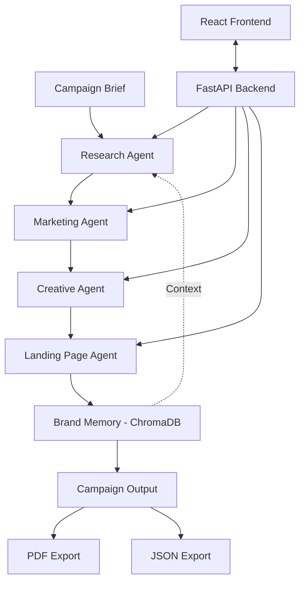

# CampaignFlow AI
### AI-Powered Marketing Automation Platform

CampaignFlow AI is an AI-powered marketing automation platform that transforms a campaign brief into a structured marketing campaign using specialized AI agents. Built with React, FastAPI, Google Gemini 2.0 Flash, and ChromaDB, the platform coordinates research, marketing strategy, creative content generation, landing page copy, and persistent brand memory through an integrated workflow.

The project demonstrates the application of **multi-agent AI orchestration, LLM-powered content generation, vector-based memory, and full-stack application development** to a real-world marketing automation use case.

---

## Table of Contents

- [Key Features](#key-features)
- [System Architecture](#system-architecture)
- [How It Works](#how-it-works)
- [Technology Stack](#technology-stack)
- [Project Structure](#project-structure)
- [Getting Started](#getting-started)
- [Author](#author)

---

## Key Features

- **Multi-Agent AI Workflow:** Coordinates specialized agents to process different stages of a marketing campaign.
- **AI-Powered Research:** Generates industry research, competitor analysis, and market insights.
- **Marketing Content Generation:** Creates Google Ads copy, social media content, and email marketing copy.
- **Creative Content Generation:** Produces campaign headlines, calls to action (CTAs), and AI image prompts.
- **Landing Page Generation:** Generates structured landing page copy, including hero sections, feature descriptions, and CTAs.
- **Persistent Brand Memory:** Uses ChromaDB vector storage to retain campaign-related knowledge and support contextual continuity.
- **AI Guardrails:** Incorporates guardrails and hallucination-control mechanisms into the AI workflow.
- **Campaign Export:** Supports exporting campaign outputs in PDF and JSON formats.
- **Interactive Dashboard:** Provides a centralized interface for campaign briefs, agent status, campaign summaries, workflow progress, and execution metrics.

---

## System Architecture

CampaignFlow AI follows a sequential multi-agent architecture in which each specialized agent contributes to the overall campaign generation process.



### Core Components

| Component | Responsibility |
|---|---|
| React Frontend | Collects campaign briefs and presents generated campaign content. |
| FastAPI Backend | Handles application requests and coordinates backend operations. |
| Research Agent | Generates industry research and competitor insights. |
| Marketing Agent | Produces advertising copy and promotional content. |
| Creative Agent | Generates headlines, CTAs, and image prompts. |
| Landing Page Agent | Creates structured landing page content. |
| ChromaDB | Stores vector-based campaign and brand memory. |
| Export Module | Produces downloadable PDF and JSON campaign outputs. |

---

## How It Works

1. **Campaign Brief:** Provide the campaign information required to define the marketing objective and context.
2. **Research:** The Research Agent generates industry insights and competitor analysis.
3. **Marketing:** The Marketing Agent develops advertising copy, social media posts, and email content.
4. **Creative Generation:** The Creative Agent produces campaign headlines, CTAs, and image prompts.
5. **Landing Page Generation:** The Landing Page Agent generates structured landing page content.
6. **Brand Memory:** Campaign-related knowledge is stored in ChromaDB for persistent vector-based memory.
7. **Export:** Generate campaign deliverables in PDF and JSON formats.

---

## Technology Stack

### Frontend
- React 18
- Babel Standalone
- Vanilla CSS
- Framer Motion

### Backend
- Python
- FastAPI
- Uvicorn

### AI and Agent Orchestration
- Google Gemini 2.0 Flash
- Prompt Engineering
- Multi-Agent Workflow

### Vector Database and Memory
- ChromaDB

### Export and Reporting
- ReportLab
- JSON

---

## Project Structure

```text
CampaignFlow-AI/
├── backend/
│   ├── main.py
│   ├── agent.py
│   ├── automation.py
│   ├── memory.py
│   ├── prompts.py
│   └── requirements.txt
│
├── frontend/
│   ├── components/
│   ├── App.jsx
│   ├── main.jsx
│   ├── styles.css
│   └── index.html
│
└── README.md
```

---

## Getting Started

### Prerequisites

- Python version compatible with the backend dependencies
- pip
- Git
- A Google Gemini API key

### 1. Clone the Repository

```bash
git clone https://github.com/vinayakkale7/CampaignFlow-AI.git
cd CampaignFlow-AI
```

### 2. Set Up the Backend

```bash
cd backend
python -m venv venv
```

Activate the virtual environment.

**Windows:**

```powershell
venv\Scripts\activate
```

**macOS / Linux:**

```bash
source venv/bin/activate
```

Install dependencies:

```bash
pip install -r requirements.txt
```

Configure your Gemini API key according to the backend's existing configuration, then start the server:

```bash
uvicorn main:app --reload
```

The backend will typically be available at `http://127.0.0.1:8000`.

Interactive API documentation: `http://127.0.0.1:8000/docs`

### 3. Start the Frontend

Open a separate terminal from the repository root:

```bash
cd frontend
python -m http.server 5500
```

Open `http://localhost:5500` in your browser.

Ensure that the frontend API configuration points to the running backend.

> **Security:** Never commit your Gemini API key or other secrets to the repository.


---

*CampaignFlow AI — Applying multi-agent AI to end-to-end marketing campaign generation.*
