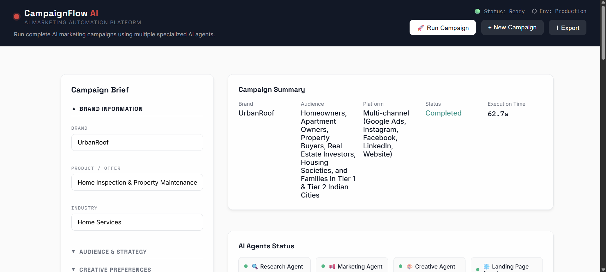
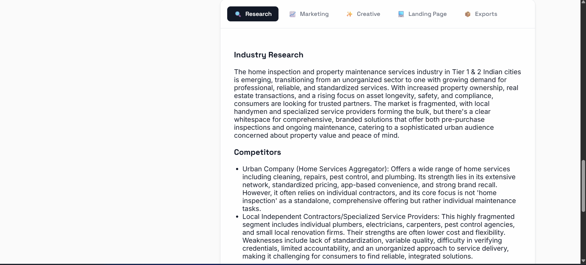
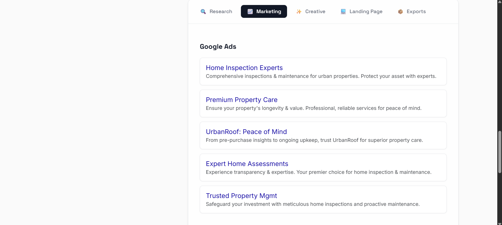
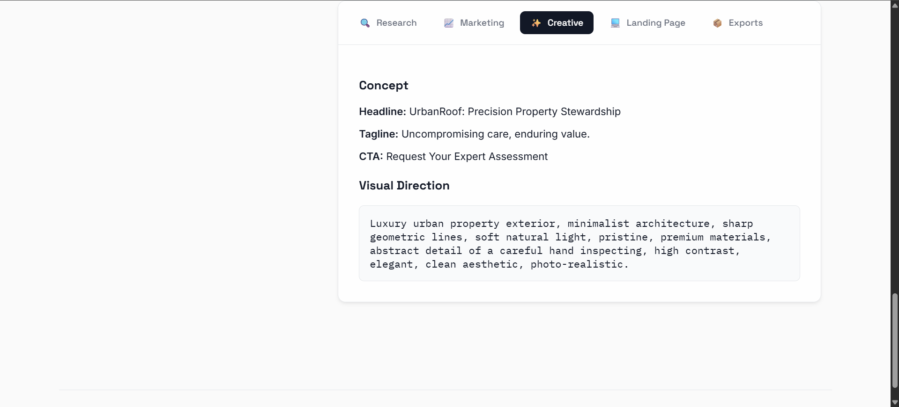
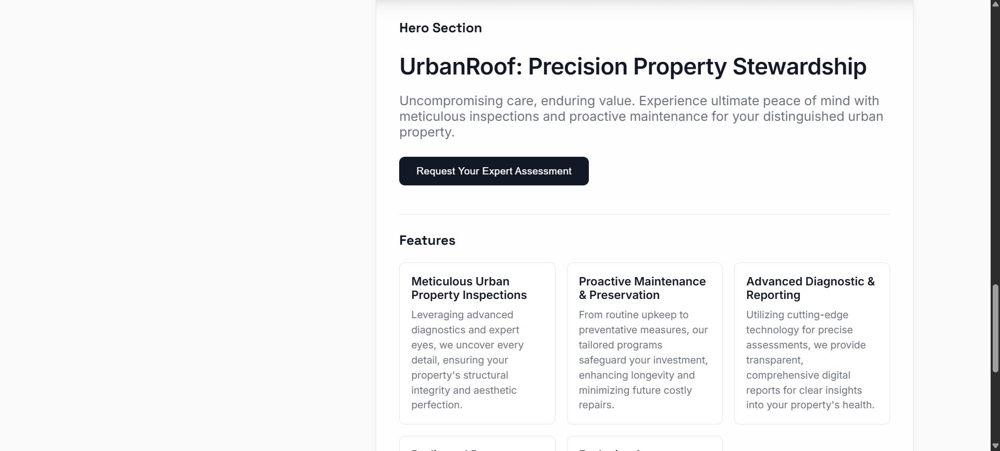

# 🚀 CampaignFlow AI

> **AI Marketing Automation Platform powered by Multi-Agent AI**

CampaignFlow AI is an autonomous AI Marketing Automation Platform that transforms a simple campaign brief into a complete marketing campaign using multiple specialized AI agents. The system orchestrates Research, Marketing, Creative, Landing Page generation, and Brand Memory while maintaining context across campaigns using vector memory.

---

## ✨ Features

- 🤖 Multi-Agent AI Workflow
- 🔍 Research Agent (Industry Research & Competitor Analysis)
- 📢 Marketing Agent (Google Ads, Social Posts, Email Copy)
- 🎨 Creative Agent (Headlines, CTAs & Image Prompts)
- 🌐 Landing Page Generator
- 🧠 Persistent Brand Memory (ChromaDB)
- 🛡️ AI Guardrails & Hallucination Control
- 📄 PDF & JSON Export
- ⚡ FastAPI + Gemini + React Architecture
- 💎 Modern Dashboard UI

---

# 🏗 Architecture

```
                Campaign Brief
                       │
                       ▼
            ┌────────────────────┐
            │ Research Agent      │
            └────────────────────┘
                       │
                       ▼
            ┌────────────────────┐
            │ Marketing Agent     │
            └────────────────────┘
                       │
                       ▼
            ┌────────────────────┐
            │ Creative Agent      │
            └────────────────────┘
                       │
                       ▼
            ┌────────────────────┐
            │ Landing Page Agent  │
            └────────────────────┘
                       │
                       ▼
            ┌────────────────────┐
            │ Brand Memory        │
            └────────────────────┘
                       │
                       ▼
          PDF + JSON + Campaign Output
```

---

# ⚙ Workflow

1. Fill Campaign Brief
2. Research Agent analyzes industry & competitors.
3. Marketing Agent generates ad copies.
4. Creative Agent creates headlines, CTAs and image prompts.
5. Landing Page Agent builds landing page content.
6. Brand Memory stores campaign knowledge.
7. Export campaign as PDF & JSON.

---

# 📷 Screenshots

## 1️⃣ Dashboard



> Campaign brief, AI agent status, campaign summary and execution metrics.

---

## 2️⃣ Research Agent



> Industry research, competitor analysis and market trends generated using Gemini AI.

---

## 3️⃣ Marketing Agent



> Google Ads, marketing copy and promotional content.

---

## 4️⃣ Creative Agent



> Headlines, CTA generation and AI image prompts.

---

## 5️⃣ Landing Page Agent



> Automatically generated Hero section, Features, CTA and Landing Page copy.

---

# 💻 Tech Stack

## Frontend

- React 18
- Babel Standalone
- Vanilla CSS
- Framer Motion

## Backend

- FastAPI
- Python
- Uvicorn

## AI

- Google Gemini 2.0 Flash
- Prompt Engineering
- Multi-Agent Workflow

## Database

- ChromaDB (Vector Memory)

## Exports

- ReportLab
- JSON

---

# 📂 Project Structure

```
CampaignFlow-AI
│
├── backend
│   ├── main.py
│   ├── agent.py
│   ├── automation.py
│   ├── memory.py
│   ├── prompts.py
│   └── requirements.txt
│
├── frontend
│   ├── components
│   ├── App.jsx
│   ├── main.jsx
│   ├── styles.css
│   └── index.html
│
└── README.md
```

---

# 🚀 Installation

## Backend

```bash
cd backend

python -m venv venv

# Windows
venv\Scripts\activate

pip install -r requirements.txt

uvicorn main:app --reload
```

---

## Frontend

```bash
cd frontend

python -m http.server 5500
```

Open

```
http://localhost:5500
```

---

# 🛣 Future Roadmap

- ✅ Knowledge Base (RAG)
- ✅ Document Upload
- ✅ AI Image Generation
- ✅ Video Ad Generation
- ✅ Real-Time Agent Streaming
- ✅ LangGraph Integration
- ✅ Multi-LLM Support
- ✅ Workflow Automation Builder

---

# 👨‍💻 Author

**Vinayak Kale**

B.Tech Artificial Intelligence & Data Science

AISSMS IOIT Pune

GitHub: https://github.com/vinayakkale7

LinkedIn: https://www.linkedin.com/in/vinayak-kale-0a06a82aa/

---
